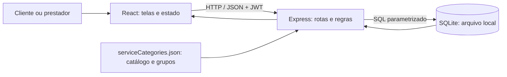
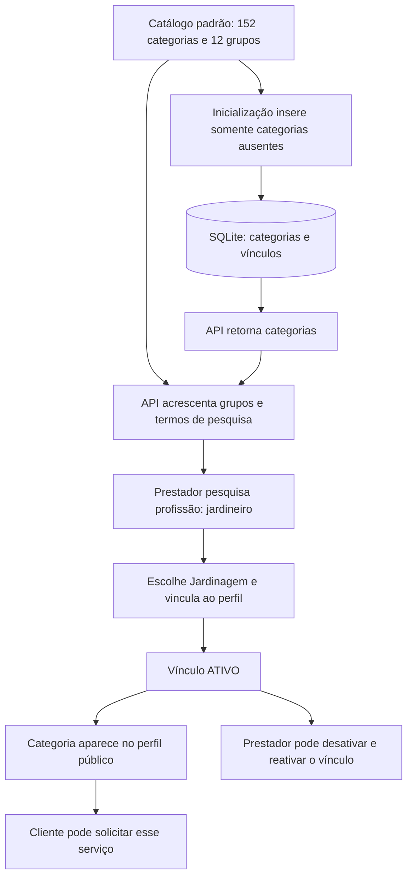
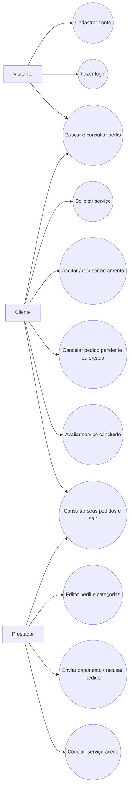
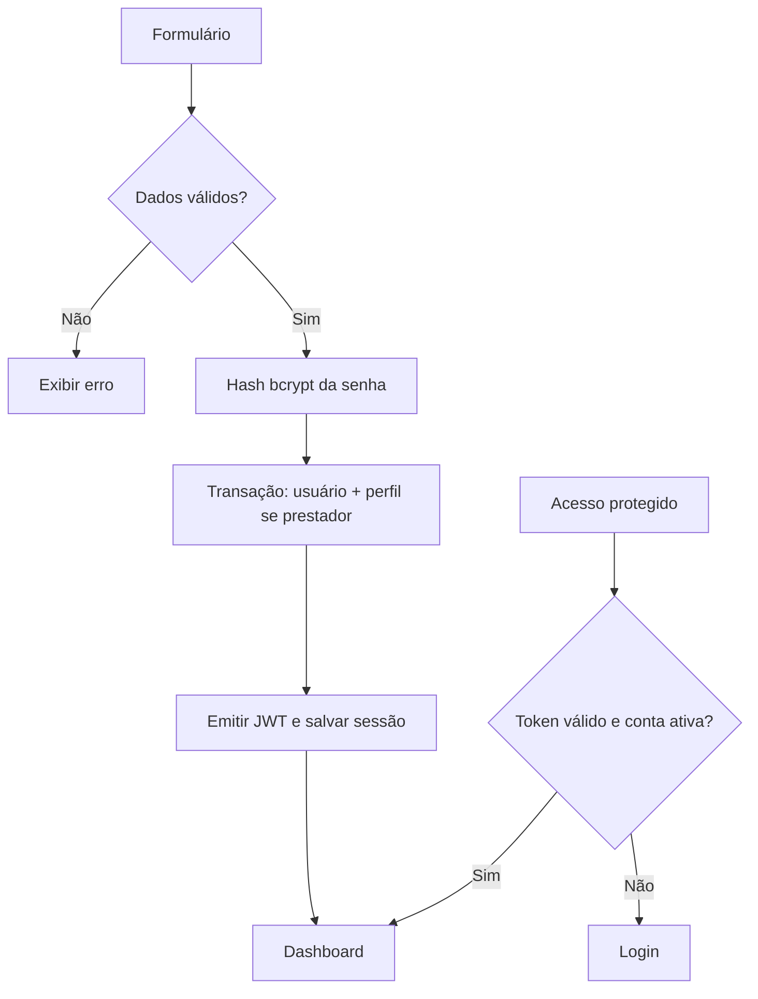
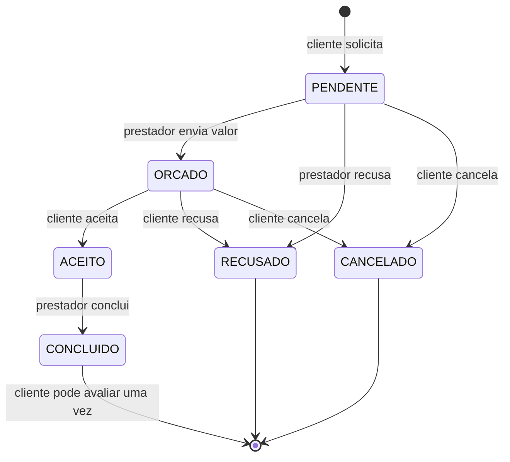
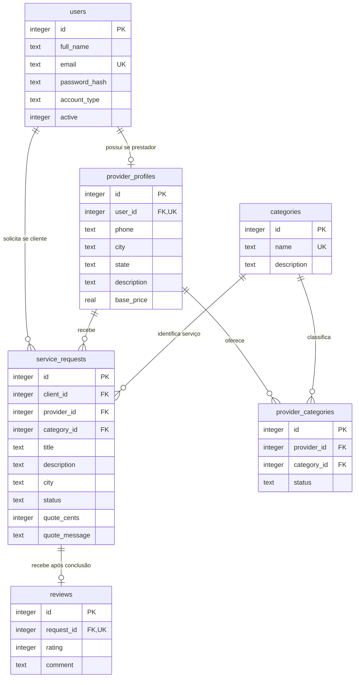

# Diagramas do To Work

Representam o comportamento implementado em 30/10/2026.

## Arquitetura

## Seleção de profissões

Os grupos e termos auxiliares são metadados do arquivo JSON; não constituem uma nova tabela no DER. O formulário para criar categorias foi removido do painel. A rota legada da API continua no código por compatibilidade, e não aparece como ação oferecida pela interface.

## Casos de uso

## Cadastro e acesso

## Estados do serviço

## Entidades e relacionamentos

Campos de data foram omitidos deste desenho resumido; o schema completo está em `backend/schema.sql`. As colunas legadas `rating`, `reviews_count` e `verified` de `provider_profiles` permanecem para preservar o banco antigo, mas não representam validação documental nem alimentam a avaliação pública atual.
